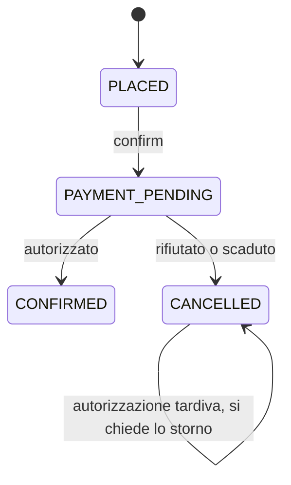

# Saga dell'ordine

## Stati

| Stato | Chi lo imposta | Da qui si va a |
| --- | --- | --- |
| PLACED | POST /orders | PAYMENT_PENDING |
| PAYMENT_PENDING | POST /orders/:id/confirm | CONFIRMED oppure CANCELLED |
| CONFIRMED | evento autorizzato | stato finale, il pivot |
| CANCELLED | rifiuto o scadenza | stato finale |

`POST /orders/:id/confirm` non conferma più l'ordine. Risponde 202 e lo stato `PAYMENT_PENDING`: il cliente legge «ordine ricevuto, ti avvisiamo». Una seconda conferma non scrive un altro comando.

## Tre esiti

**Confermato.** Il comando `autorizza` parte insieme al passaggio a `PAYMENT_PENDING`. payment-service inserisce una riga `AUTHORIZED` e risponde `autorizzato`. order-service passa a `CONFIRMED` e pubblica `OrdineConfermato`. La notifica è una sola.

**Rifiutato.** Sopra `PAYMENT_LIMIT_CENTS` (500 euro) la decisione è `REJECTED`. L'ordine diventa `CANCELLED` con il motivo e parte `OrdineAnnullato`. Non si disfa un passo precedente: l'annullamento è una transizione nuova.

**Scaduto.** Se entro `SAGA_TIMEOUT_S` (30 secondi) non arriva risposta, il job annulla l'ordine. Se l'autorizzazione arriva dopo, l'ordine non si riapre: si pubblica `storna` e il pagamento, se era `AUTHORIZED`, diventa `VOIDED`.

Ogni transizione ha `WHERE status = 'PAYMENT_PENDING'`. Un duplicato non trova la riga nello stato atteso e non cambia nulla. La scadenza usa `FOR UPDATE SKIP LOCKED`, così due repliche non annullano due volte lo stesso ordine.

La conferma è il pivot. Un passo successivo che può fallire, per esempio la spedizione, non potrebbe più tornare indietro con un semplice annullamento del pagamento: servirebbe una compensazione nuova, esplicita, dopo il pivot.
